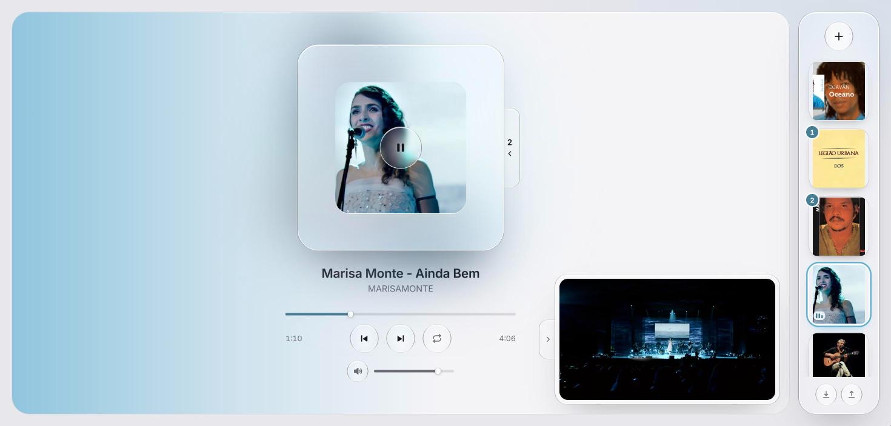

# Plauer

Player de músicas do YouTube em uma página só, feito à mão com HTML, CSS e JavaScript puros: sem framework e sem etapa de build.

Você monta sua biblioteca de capas, clica numa delas e ela voa até o player. O fundo assume a cor da capa, a fila fica numa gaveta que desliza para fora do player, e tudo é desenhado em *liquid glass*.

**→ [plauer.gabrueldev.com](https://plauer.gabrueldev.com)**



---

## Funcionalidades

- **Biblioteca de capas**: adicione músicas colando um link do YouTube ou pesquisando pelo nome.
- **Capa voando até o player**: se nada estiver tocando, a música começa na hora. Se algo já estiver tocando, a gaveta da fila abre, a capa voa até o fim da fila e a gaveta fecha sozinha.
- **Fundo na cor da música**: a cor dominante da capa vira um gradiente no palco e uma aura atrás do vidro, com transição suave entre as músicas.
- **Fila**: o badge na capa mostra a posição, clicar num item da fila toca ele na hora, e dá para tirar itens da fila.
- **Controles**: play/pause, reiniciar, próxima, barra de progresso (clicar, arrastar ou usar as setas), volume com mudo e repetir (desligado → repetir fila → repetir esta música).
- **Vídeo no canto**: o player oficial do YouTube fica visível no canto do palco. Uma lingueta com seta recolhe e mostra o vídeo.
- **Pesquisa**: resultados com capa, título, canal e duração, com "tocar agora" ou "adicionar".
- **Abre offline**: um service worker guarda o site, as capas e as fontes. Sem internet, o app avisa em vez de pular a fila.
- **Exportar e importar** a biblioteca em `.json`.
- **Mobile**: a biblioteca vira uma faixa horizontal e a gaveta da fila abre para cima.

### Atalhos

| Tecla | Ação |
|---|---|
| `Espaço` | Tocar / pausar |
| `↑` `↓` | Volume (±5%) |
| `←` `→` na barra de progresso | Voltar / avançar 5 s |
| `Esc` | Fechar o modal |

---

## Como foi feito

### Cor da capa → fundo

A miniatura do YouTube (`i.ytimg.com`, que libera CORS) é desenhada num canvas de 48×27 px, e a cor é escolhida em três tentativas:

1. **Cor que mais aparece.** Os pixels são agrupados em 24 faixas de matiz. Cores saturadas e de luminosidade média pesam mais, e a faixa vencedora, somada às vizinhas, vira a cor.
2. **Capa sem cor viva** (preto e branco, por exemplo): usa a média da borda da imagem.
3. **Canvas bloqueado**: tenta de novo por um proxy com CORS e, em último caso, gera uma cor a partir do ID do vídeo.

O resultado é ajustado (saturação mínima e luminosidade entre 38% e 60%) e guardado junto da música, então é calculado uma vez só. A transição entre cores usa `@property --accent` registrada como `<color>`, o que deixa o CSS animar o gradiente.

### Liquid glass

Um modelo próprio: preenchimento branco radial (mais forte no centro), fio branco em cima, traço escuro de 1px só nas laterais e contorno de meio pixel. Nos botões redondos, o traço lateral é um anel com máscara. As placas grandes (player, gaveta, biblioteca) usam o mesmo modelo com o branco mais denso, e o blur atrás refrata a aura e o gradiente.

### Animações

- **Capa voando**: um clone da capa com `position: fixed` é animado com a Web Animations API, do retângulo de origem até o de destino, com um arco e uma leve rotação no meio do caminho. Na fila, uma linha tracejada reserva o lugar antes de a capa chegar.
- **Gaveta**: fica atrás do corpo do player e desliza com um easing levemente elástico.
- Só `transform` e `opacity` são animados, e tudo respeita `prefers-reduced-motion`.

### Player

Usa a [IFrame Player API](https://developers.google.com/youtube/iframe_api_reference) oficial. O app controla play, pause, seek e volume, e escuta os estados para avançar a fila, repetir e tratar vídeos que bloqueiam incorporação (erros 101/150), que são pulados com um aviso.

### Pesquisa

A pesquisa passa por um Cloudflare Worker no mesmo domínio (`/search`), que consulta o YouTube e devolve uma lista enxuta:

```
GET /search?q=texto → { "results": [{ "vid", "title", "author", "duration" }] }
```

O Worker guarda cada termo em cache por 6 horas e só responde ao próprio site e ao `localhost`. **O código dele não está neste repositório** (veja [Termos de uso](#termos-de-uso-e-limitações)). Sem ele, o app funciona normalmente colando links.

### Dados

Tudo fica no `localStorage` do navegador, sem backend nem conta. O acesso passa por um único objeto `store`, então trocar o armazenamento no futuro (por exemplo, sincronizar entre aparelhos) mexe em um lugar só.

```js
// chave "player:v1"
{
  lib: [{ id, vid, name, author, color }],
  queue: ["id", ...],          // aceita repetição
  current: "id" | null,
  volume: 0–100, muted, repeat: "off" | "all" | "one",
  showVideo: true | false | null   // null = decide pelo tamanho da tela
}
```

### Offline

O service worker (`sw.js`) usa estratégias diferentes para cada tipo de arquivo:

- **Arquivos do site**: rede primeiro, cache como reserva. Online, você sempre recebe a versão mais nova.
- **Capas e fontes**: cache primeiro, com limite de 400 capas. Só guarda respostas CORS, porque as respostas opacas ocupam cerca de 7 MB cada na cota do navegador.
- **Player do YouTube e pesquisa**: nunca vão para o cache.

O som continua precisando de internet, porque o áudio vem por streaming do player oficial.

### Acessibilidade

Os botões têm `aria-label`, as barras de progresso e de volume são `role="slider"` com teclado, o foco é visível, os avisos usam `aria-live` e o modal é um `<dialog>` nativo.

---

## Estrutura

```
.
├── index.html       marcação: palco, player, gaveta, biblioteca, modal
├── style.css        tokens, liquid glass, layout, mobile, reduced motion
├── app.js           estado, cor da capa, player, fila, animações, pesquisa, offline
├── sw.js            service worker (cache do site, das capas e das fontes)
├── wrangler.toml    configuração do Cloudflare Worker (site + /search)
├── .assetsignore    arquivos que não sobem para o site
└── docs/
    └── screenshot.jpg
```

## Rodando localmente

Precisa ser servido por HTTP: abrir o arquivo direto (`file://`) quebra a API do YouTube. Use `localhost`, e não `127.0.0.1`, porque o YouTube recusa tocar em páginas abertas por IP.

```bash
npx serve .
# ou
python3 -m http.server 5391
```

Com o Worker de pesquisa na pasta `worker/`, `npx wrangler dev` sobe o site e a pesquisa juntos em `http://localhost:8788`.

## Deploy

O site e a pesquisa são um único Cloudflare Worker com *static assets*, publicado em um subdomínio próprio:

```bash
npx wrangler login
npx wrangler deploy
```

O domínio fica em `routes` no `wrangler.toml` (`custom_domain = true`), e o `.assetsignore` impede que arquivos internos sejam publicados.

---

## Termos de uso e limitações

O Plauer é um **projeto pessoal de estudo, sem fins comerciais**, e **não tem nenhuma ligação com o YouTube ou o Google**.

- **Player oficial e visível.** A reprodução usa a IFrame Player API do YouTube, e o vídeo aparece por padrão no canto do palco, com 200 px de altura, o mínimo das diretrizes da API. A opção de recolher o vídeo enquanto a música toca fica **fora** das [políticas da API do YouTube](https://developers.google.com/youtube/terms/developer-policies) e existe apenas para uso pessoal.
- **Pesquisa.** O Worker de pesquisa usa um endpoint interno, não documentado, do site do YouTube, o que não é permitido pelos [Termos de Serviço do YouTube](https://www.youtube.com/t/terms). Por isso o código dele não está publicado aqui, e a pesquisa pode parar de funcionar a qualquer momento. A alternativa dentro das regras é a [YouTube Data API](https://developers.google.com/youtube/v3) oficial, com chave e cota diária.
- **Nada é baixado.** O app não baixa, converte nem armazena áudio ou vídeo. Todo o som vem do player oficial, por streaming, e conta como visualização normal para quem publicou o vídeo.
- **Direitos.** Músicas, vídeos, capas e títulos pertencem aos seus autores e detentores de direitos.
- **Vídeos bloqueados.** Alguns vídeos não permitem reprodução fora do YouTube. O app avisa e pula para o próximo.
- **Celular.** No celular, o som para quando a tela bloqueia ou o navegador vai para segundo plano. É uma limitação do player incorporado.
- **Sem visualizador de áudio real.** O som fica preso dentro do iframe, então o equalizer na capa é só uma animação ligada ao play/pause.
